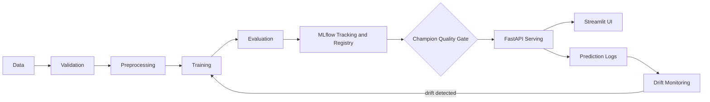

<div align="center">

# 🏦 LoanLens

### Loan Approval Prediction with an End-to-End Local MLOps Lifecycle

[](https://github.com/KAVINGUPTA09/loanops/actions/workflows/ci.yml)
[](https://github.com/KAVINGUPTA09/loanops/actions/workflows/cd.yml)


**CPU-only · Beginner-friendly · Fully reproducible · Windows / Linux / macOS**

[Quick Start](#-quick-start) · [Pipeline](#-pipeline-overview) · [API](#-api-serving) · [Dashboard](#-streamlit-dashboard) · [Monitoring](#-drift-monitoring--retraining) · [Viva](#-viva-cheat-sheet)

</div>

---

## 📌 Overview

Banks receive loan applications containing income, credit history, education,
dependents and property details. Manual review is slow and inconsistent.

**LoanLens** estimates loan approval probability through FastAPI and Streamlit,
while implementing validation, reproducible preprocessing, MLflow tracking and
registry, champion quality gates, logging, drift monitoring and retraining.



> ⚠️ **Academic honesty:** The bundled dataset is synthetic and for
> demonstration only. Real lending requires approved data, privacy controls,
> authentication, durable storage and human/business review.

## ✨ Features

| Area | What you get |
|---|---|
| 🧪 Data validation | Schema, range and target checks with non-zero failure |
| 🔧 Leak-free preprocessing | Imputation, scaling and one-hot encoding inside the saved pipeline |
| 🤖 Model comparison | Logistic Regression, Random Forest and XGBoost |
| 📊 Experiment tracking | MLflow params, metrics, hashes and image artifacts |
| 🏆 Champion quality gate | Promotion only after configured ROC-AUC improvement |
| 🔍 Explainability | SHAP summary plot and top-three prediction reasons |
| ⚖️ Fairness | Approval rate and recall by Gender and Married |
| 🚀 Serving | FastAPI, Swagger and thread-safe prediction logging |
| 🖥️ Dashboard | Streamlit prediction, history, monitoring and registry views |
| 📉 Drift monitoring | Evidently with SciPy KS-test/chi-square fallback |
| ♻️ Retraining | One command reruns the training lifecycle |
| 📦 Reproducibility | DVC, pinned dependencies, Docker and GitHub Actions |

## 📊 Dataset

The sample generator creates 600 realistic-looking records with missing values,
income/credit correlations and Kaggle-compatible columns:

```text
Loan_ID, Gender, Married, Dependents, Education, Self_Employed,
ApplicantIncome, CoapplicantIncome, LoanAmount, Loan_Amount_Term,
Credit_History, Property_Area, Loan_Status
```

`Loan_Status` is the target: `Y` means approved and `N` means rejected.

## 🗂️ Repository Structure

```text
loanops/
├── app/main.py                    FastAPI prediction service
├── frontend/streamlit_app.py      LoanLens dashboard
├── src/
│   ├── utils.py                   Params, paths and helpers
│   ├── validate_data.py            Schema and range validation
│   ├── preprocess.py               Cleaning and train/test split
│   ├── train.py                    Training, MLflow and quality gate
│   ├── evaluate.py                 Metrics and evaluation plots
│   ├── explain.py                  SHAP summary plot
│   ├── fairness.py                 Group approval/recall report
│   ├── drift.py                   Drift tests and HTML report
│   └── retrain.py                 Retraining after drift
├── scripts/
│   ├── make_sample_data.py         Generate sample data
│   ├── setup_dvc.py                Configure local DVC remote
│   ├── simulate_drift.py           Generate drifted production data
│   └── smoke_test.py               End-to-end verification
├── tests/                          Pytest tests
├── data/                            Dataset and generated CSV files
├── models/                          Local model outputs
├── reports/                         Evaluation and monitoring outputs
├── params.yaml                     Central configuration
├── dvc.yaml, dvc.lock              Reproducible pipeline
├── Dockerfile, docker-compose.yml
├── .github/workflows/              CI, CD and scheduled drift check
├── requirements.txt                Exact dependency versions
├── VIVA_PREP.md                    Viva questions and demo script
└── SELF_AUDIT.md                   Validation and common fixes
```

## 🚀 Quick Start

### 🪟 Windows PowerShell

```powershell
cd "F:\mse2 genai"
py -3.12 -m venv .venv
Set-ExecutionPolicy -Scope Process -ExecutionPolicy RemoteSigned
.\.venv\Scripts\Activate.ps1

python -m pip install --upgrade pip
pip install -r requirements.txt

python scripts\make_sample_data.py
python scripts\setup_dvc.py
dvc repro
python scripts\smoke_test.py
```

Python 3.11 is also supported. If it is unavailable, Python 3.12 is fine.
`SQLAlchemy==2.0.36` is pinned intentionally for MLflow compatibility.

### 🐧 Linux / 🍎 macOS

```bash
python3.11 -m venv .venv
source .venv/bin/activate
python -m pip install --upgrade pip
pip install -r requirements.txt

python scripts/make_sample_data.py
python scripts/setup_dvc.py
dvc repro
python scripts/smoke_test.py
```

Expected smoke-test output:

```text
PASS sample data
PASS validate
PASS preprocess
PASS train
PASS evaluate
PASS explain
PASS fairness
PASS API /health
PASS API /predict
PASS simulate drift
PASS drift check
PASS retrain trigger
```

## 🔄 Pipeline Overview

DVC stages are:

```text
validate → preprocess → train → evaluate → explain → fairness
```

| # | Stage | Command | What it does |
|---|---|---|---|
| 1 | Data | `python scripts\make_sample_data.py` | Writes fallback `data/loan.csv` |
| 2 | Validate | `python -m src.validate_data` | Checks columns, rows, ranges and target |
| 3 | Preprocess | `python -m src.preprocess` | Converts `3+`, target and stratified split |
| 4 | Train | `python -m src.train` | Trains three models and applies quality gate |
| 5 | Evaluate | `python -m src.evaluate` | Metrics, confusion matrix and ROC curve |
| 6 | Explain | `python -m src.explain` | SHAP summary plot |
| 7 | Fairness | `python -m src.fairness` | Group approval-rate and recall report |

### Model preprocessing

The saved sklearn pipeline performs:

- Numeric columns: median imputation and standard scaling
- Categorical columns: most-frequent imputation and one-hot encoding

Keeping preprocessing inside the model prevents training-serving skew.

Generated outputs:

```text
models/best_model.joblib       models/model_info.json
reports/metrics.json           reports/confusion_matrix.png
reports/roc_curve.png          reports/shap_summary.png
reports/fairness.json
```

## 🏆 MLflow Registry & Quality Gate

| Item | Value |
|---|---|
| Backend DB | `mlflow.db` local SQLite |
| Artifacts | `mlruns/` |
| Registered model | `loan_model` |
| Alias | `champion` |

A new model becomes `champion` only if ROC-AUC improves over the current
champion by at least `training.min_improvement` in `params.yaml`. If the
registry is unavailable, the local joblib model remains available.

```powershell
mlflow ui --backend-store-uri sqlite:///mlflow.db --host 127.0.0.1 --port 5000
```

Open [http://localhost:5000](http://localhost:5000).

## ⚡ API Serving

```powershell
.\.venv\Scripts\Activate.ps1
uvicorn app.main:app --reload
```

Swagger: [http://localhost:8000/docs](http://localhost:8000/docs)

| Endpoint | Purpose |
|---|---|
| `GET /health` | API/model readiness and champion version |
| `GET /model-info` | Selected model metrics and training metadata |
| `POST /predict` | Prediction, probability and top-three SHAP reasons |

Example request:

```json
{
  "Gender": "Male",
  "Married": "Yes",
  "Dependents": "0",
  "Education": "Graduate",
  "Self_Employed": "No",
  "ApplicantIncome": 5000,
  "CoapplicantIncome": 2000,
  "LoanAmount": 150,
  "Loan_Amount_Term": 360,
  "Credit_History": 1,
  "Property_Area": "Urban"
}
```

Every successful prediction is appended to `data/production_log.csv`:

```powershell
Import-Csv .\data\production_log.csv | Select-Object -Last 5
```

## 🖥️ Streamlit Dashboard

Keep the API running and open another terminal:

```powershell
.\.venv\Scripts\Activate.ps1
streamlit run frontend\streamlit_app.py
```

Open [http://localhost:8501](http://localhost:8501).

Dashboard includes:

- Real-time loan form
- API health and champion version
- Approval probability and decision card
- SHAP top-three reasons
- Prediction history and approval-rate chart
- Drift simulation, drift-check and retraining buttons
- Model registry metadata

Try:

| Applicant | Income | Loan amount | Credit history |
|---|---:|---:|---:|
| 💪 Strong | `10000` | `100` | `1` |
| ⚠️ Weak | `2000` | `300` | `0` |

The output is probabilistic and is not a real banking decision.

## 📉 Drift Monitoring & Retraining

The monitor compares training data with `data/production_log.csv`.

```powershell
python scripts\simulate_drift.py
python -m src.drift
python -m src.retrain
```

Monitoring uses Evidently when available, with SciPy KS-test for numeric
columns and chi-square for categorical columns. The report is:

```text
reports/drift_report.html
```

Exit codes:

| Code | Meaning |
|---:|---|
| `0` | No actionable drift or too few rows |
| `2` | Drift share reached the configured threshold |

Retraining reruns preprocessing, training, evaluation, SHAP and fairness.

## 📦 DVC, Docker & CI/CD

### DVC

Git tracks code/configuration; DVC tracks dataset pointers and pipeline state.
`setup_dvc.py` creates the local `.dvc-storage` remote and is safe to rerun.

```powershell
dvc status
dvc dag
dvc repro
dvc push
```

### Docker

Docker Desktop is optional locally. GitHub Actions builds the image remotely.
If Docker is installed:

```powershell
docker compose up --build
```

| Service | URL |
|---|---|
| FastAPI | `http://localhost:8000` |
| Streamlit | `http://localhost:8501` |
| MLflow | `http://localhost:5000` |

### GitHub Actions

| Workflow | Trigger | What it does |
|---|---|---|
| `ci.yml` | Push / PR | Install → data → DVC → repro → Flake8 → Pytest → Docker build |
| `cd.yml` | Push to `main` | Publishes image to GHCR |
| `drift_check.yml` | Manual / weekly | Runs drift check and uploads HTML report |

Published image:

```text
ghcr.io/kavingupta09/loanops:latest
ghcr.io/kavingupta09/loanops:<commit-sha>
```

AWS ECR/ECS deployment is intentionally postponed; the GitHub/GHCR workflow
is complete and verified.

## 🧪 Testing

```powershell
pytest -q
flake8 src app scripts
python -m compileall -q src app scripts
```

Tests cover API health, invalid input validation (`422`), dataset validation,
tiny pipeline fit/predict and the full smoke lifecycle.

## ⚙️ Configuration

All central settings live in `params.yaml`:

| Setting | Meaning |
|---|---|
| `random_state` | Reproducibility seed |
| `paths.*` | Data, model and report paths |
| `training.test_size` | Test split proportion |
| `training.min_improvement` | Minimum ROC-AUC promotion gain |
| `training.approval_threshold` | Minimum approval probability; `0.65` means 65%+ is Approved |
| `training.models.*` | Model hyperparameters |
| `drift.threshold` | Drift share needed for a trigger |
| `drift.min_rows` | Minimum production rows |

## 🎬 One-Minute Demo Order

1. Run `uvicorn app.main:app --reload`.
2. Run `streamlit run frontend\streamlit_app.py`.
3. Submit strong and weak applicants.
4. Show probability and SHAP reasons.
5. Show `data/production_log.csv`.
6. Open MLflow and show runs, `loan_model` and `champion`.
7. Click **Simulate Production Drift**, then **Run Drift Check**.
8. Show `reports/drift_report.html`.
9. Explain candidate retraining and the quality gate.
10. Show green GitHub Actions and the GHCR image.

## 🎓 Viva Cheat Sheet

### Why three models?

Logistic Regression is a baseline, Random Forest captures non-linear rules and
XGBoost is a strong boosted-tree candidate. All use the same test split.

### Why ROC-AUC and F1?

ROC-AUC measures ranking across thresholds. F1 balances precision and recall;
accuracy alone can mislead with imbalanced classes.

### Why MLflow?

It records parameters, metrics, artifacts and model versions. The `champion`
alias gives serving a stable model name.

### Why DVC?

Git is for code; DVC stores dataset version metadata and pipeline state.

### What is training-serving skew?

Training and production transform data differently. The saved sklearn pipeline
keeps imputation, scaling and encoding identical.

### What is drift?

Production feature distributions differ from training distributions. The
monitor checks numeric and categorical drift and can trigger retraining.

### Why SHAP and fairness?

SHAP explains feature influence for one prediction. Fairness compares approval
rate and recall across groups; it is diagnostic, not legal certification.

More questions and the four-person demo script: [VIVA_PREP.md](VIVA_PREP.md).

## 🛠️ Troubleshooting

| Problem | Fix |
|---|---|
| Python 3.11 not found | Use `py -3.12 -m venv .venv` |
| Activation blocked | `Set-ExecutionPolicy -Scope Process RemoteSigned` |
| MLflow SQLAlchemy error | Reinstall `SQLAlchemy==2.0.36` |
| Port 8000 busy | `uvicorn app.main:app --port 8001` |
| Port 8501 busy | `streamlit run frontend/streamlit_app.py --server.port 8502` |
| API offline in UI | Start FastAPI before Streamlit |
| No production log | Submit an API/UI prediction |
| Too few drift rows | Run `python scripts\simulate_drift.py` |
| GHCR tag invalid | Image repository names must be lowercase |
| CI imports fail | Keep `pytest.ini` and workflow `PYTHONPATH` |
| Docker unavailable locally | Use GitHub Actions; Docker Desktop is optional |
| DVC cannot initialize | Run `python scripts\setup_dvc.py` |

Full details: [SELF_AUDIT.md](SELF_AUDIT.md).

## ⚠️ Limitations & Future Work

Current limitations:

- Synthetic data is unsuitable for real lending decisions.
- Local SQLite MLflow is not highly available.
- Local filesystem logs are ephemeral on many cloud platforms.
- The API has no authentication or rate limiting.
- Drift uses proxy feedback because immediate ground-truth labels are absent.
- Fairness summaries need domain, legal and statistical review.

Future production work:

- Managed MLflow with PostgreSQL and S3
- AWS ECR/ECS or Kubernetes deployment
- Secrets Manager and IAM/OIDC
- Durable production event storage
- Scheduled monitoring with labelled outcomes
- Model approval workflow and rollback
- Privacy, audit, access control and bias review

## 🔗 Links

- Repository: https://github.com/KAVINGUPTA09/loanops
- [VIVA_PREP.md](VIVA_PREP.md)
- [SELF_AUDIT.md](SELF_AUDIT.md)
- [params.yaml](params.yaml)
- [dvc.yaml](dvc.yaml)
- [src/train.py](src/train.py)
- [app/main.py](app/main.py)
- [frontend/streamlit_app.py](frontend/streamlit_app.py)

<div align="center">

**Built as a college MLOps project · Made with ❤️ using Python**

</div>
