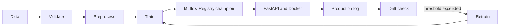

# Loan Approval Prediction with MLOps

Beginner-friendly CPU project: data validation, reproducible preprocessing, three models, MLflow tracking, registry alias, FastAPI serving, Streamlit UI, monitoring, tests, Docker and CI.

## Run on Windows PowerShell

```powershell
py -3.11 -m venv .venv
.\.venv\Scripts\Activate.ps1
pip install -r requirements.txt
python scripts\make_sample_data.py
python scripts\setup_dvc.py
dvc repro
python scripts\smoke_test.py
uvicorn app.main:app --reload
```

Open `http://localhost:8000/docs`. Run the UI separately with `streamlit run frontend/streamlit_app.py`.
For drift demo: `python scripts\simulate_drift.py; python -m src.drift`. Exit code `2` means drift crossed the threshold; then run `python -m src.retrain`.

## Run on Linux or macOS

```bash
python3.11 -m venv .venv
source .venv/bin/activate
pip install -r requirements.txt
python scripts/make_sample_data.py
python scripts/setup_dvc.py
dvc repro
python scripts/smoke_test.py
uvicorn app.main:app --reload
```

## Start each service

```powershell
# API
uvicorn app.main:app --host 0.0.0.0 --port 8000
# UI
streamlit run frontend/streamlit_app.py --server.port 8501
# MLflow
mlflow ui --backend-store-uri sqlite:///mlflow.db --host 0.0.0.0 --port 5000
# Docker
docker compose up --build
```

The local DVC remote is `.dvc-storage`. For a normal Git checkout, run `git init`,
`python scripts/setup_dvc.py`, `dvc push`, and commit `dvc.yaml`, `dvc.lock`,
and `data/loan.csv.dvc`. Do not commit the generated model, MLflow database,
production log, or local DVC cache.

## GitHub setup

Push the repository to GitHub. The CI workflow installs dependencies, creates
sample data, configures DVC, runs `dvc repro`, flake8, pytest and Docker build.
The CD workflow publishes `ghcr.io/<owner>/<repository>:<commit-sha>` and
`:latest`. Add the optional repository secret `RENDER_DEPLOY_HOOK` to trigger
a Render deploy; without it, the workflow reports a safe skip.

## MLflow and DVC

Training logs one run per model to the local SQLite MLflow backend. The best registered version is assigned the `champion` alias only when its ROC-AUC improves by `min_improvement`; otherwise the existing champion remains active. Open the UI with `mlflow ui --backend-store-uri sqlite:///mlflow.db`.

```powershell
dvc init
dvc add data\loan.csv
dvc repro
dvc dag
```

## MLOps map

| Concept | Implementation |
|---|---|
| Data versioning | `dvc.yaml`, DVC |
| Experiment tracking | `src/train.py`, MLflow |
| Model registry and quality gate | `src/train.py`, `loan_model@champion` |
| Reproducibility | `params.yaml`, fixed seeds |
| Serving | `app/main.py`, Docker |
| Monitoring | `src/drift.py` |
| Explainability | `src/explain.py`, SHAP |
| Fairness | `src/fairness.py` |
| Automation | `.github/workflows/` |

This local demo uses a filesystem log. Production deployments should use durable object storage and a scheduled monitoring job; free hosting filesystems are ephemeral.

## Architecture



See [VIVA_PREP.md](VIVA_PREP.md) for viva questions and [SELF_AUDIT.md](SELF_AUDIT.md) for checks and common fixes.
