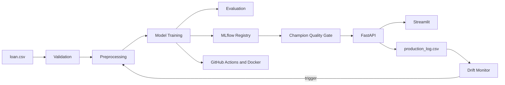

# LoanLens: Loan Approval Prediction MLOps Project

## 1. Abstract

LoanLens is an end-to-end academic MLOps system that predicts loan approval
probability from applicant information. It combines data validation,
reproducible preprocessing, multi-model training, MLflow tracking and model
registry, FastAPI serving, Streamlit visualization, explainability, fairness
reporting, drift monitoring, retraining and GitHub Actions CI/CD.

The bundled Kaggle dataset is used only to demonstrate the complete technical
lifecycle: https://www.kaggle.com/datasets/tanishaj225/loancsv?resource=download

## 2. Objectives

- Build a reproducible loan approval prediction pipeline.
- Compare Logistic Regression, Random Forest and XGBoost.
- Track experiments and model versions with MLflow.
- Serve predictions through a validated REST API.
- Provide a user-friendly Streamlit dashboard.
- Explain predictions with SHAP and compare group metrics.
- Detect production data drift and trigger retraining.
- Validate the project automatically with CI/CD.

## 3. System Architecture



## 4. Methodology

The DVC pipeline is:

```text
validate -> preprocess -> train -> evaluate -> explain -> fairness
```

Numeric columns use median imputation and scaling. Categorical columns use
most-frequent imputation and one-hot encoding. The complete preprocessing and
model are saved as one sklearn pipeline to prevent training-serving skew.

## 5. Model and Evaluation

The system trains Logistic Regression, Random Forest and XGBoost on the same
split. Models are compared using accuracy, precision, recall, F1 and ROC-AUC.
The best candidate is registered in MLflow. The current champion is promoted
only when its ROC-AUC improves by the configured minimum.

The application uses a configurable approval threshold of 65%:

```text
probability >= 0.65 -> Approved
probability < 0.65  -> Rejected
```

## 6. MLOps Components

| Component | Implementation |
|---|---|
| Data versioning | DVC and local DVC remote |
| Experiment tracking | MLflow SQLite backend |
| Model registry | `loan_model` with `champion` alias |
| Serving | FastAPI |
| UI | Streamlit |
| Explainability | SHAP |
| Fairness | Group approval rate and recall |
| Drift | Evidently report with SciPy fallback |
| Retraining | `python -m src.retrain` |
| Packaging | Docker |
| Automation | GitHub Actions CI/CD |

## 7. Results and Monitoring

The application logs successful predictions to `data/production_log.csv`.
The drift monitor compares training features with the production batch using
KS tests for numeric columns and chi-square tests for categorical columns.
When the configured drift share threshold is reached, the monitor returns
`DRIFT_TRIGGERED` and retraining can be started.

SHAP returns top feature contributions for each prediction. Fairness reports
approval rate and recall by Gender and Married groups.

## 8. Testing

```powershell
pytest -q
flake8 src app scripts
python -m compileall -q src app scripts
python scripts\smoke_test.py
```

CI repeats the reproducible pipeline, linting, tests and Docker build on push
and pull request. CD publishes the image to GHCR.

## 9. Limitations and Future Scope

The dataset source is Kaggle (https://www.kaggle.com/datasets/tanishaj225/loancsv?resource=download), MLflow is local, the production log is filesystem
based, and the API does not yet include authentication or rate limiting.
AWS ECR/ECS deployment and cloud MLflow with S3/PostgreSQL are reserved for
the next deployment phase.

## 10. Conclusion

LoanLens demonstrates the complete academic MLOps lifecycle from data
validation to monitored serving and retraining. It is reproducible locally,
containerized, tested automatically and honest about the additional controls
required for a real lending production system.
